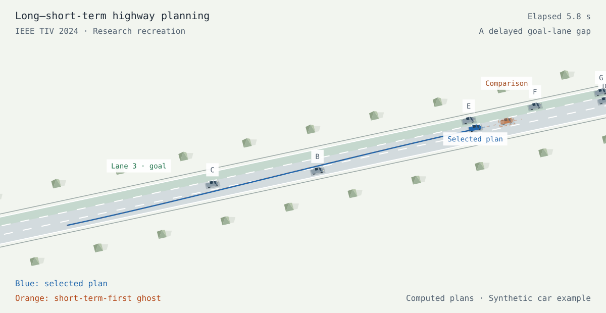
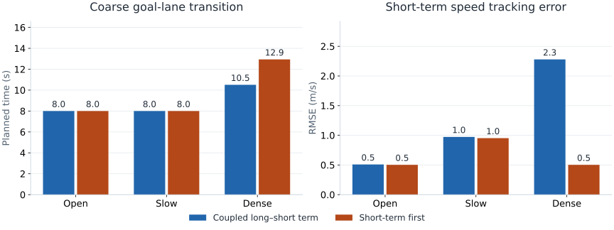

# Long–Short Lane Planning

**A Long-Short-Term Mixed-Integer Formulation for Highway Lane Change Planning**

Rudolf Reiter · Armin Nurkanović · Daniele Bernardini · Moritz Diehl · Alberto Bemporad

IEEE Transactions on Intelligent Vehicles · TIV 2024. [IEEE Transactions on Intelligent Vehicles 9(11), 7514–7528](https://doi.org/10.1109/TIV.2024.3398805).

> **Recreated implementation — not the original repository.** This independent, simplified implementation demonstrates the paper’s core ideas. All reported numbers are new synthetic results, not recovered original experiments.

[Paper](https://publications.syscop.de/Reiter2024.pdf) · [Interactive page](https://RudolfReiter.github.io/highway-lane-planning/) · [Reproduction details](REPRODUCTION.md) · [Evaluation data](docs/data/summary.json)



A lane change is part of a longer journey. Explore how a detailed short-term motion plan can account for gaps several lanes ahead through continuous transition times and positions.

[Download the animated scene preview](docs/assets/driving-preview.gif) (opens separately).

## Run locally

```bash
git clone https://github.com/RudolfReiter/highway-lane-planning.git
cd highway-lane-planning
python -m venv .venv
source .venv/bin/activate
python -m pip install -r requirements-reproduce.txt -e .
python -m highway_planning.experiment
python scripts/plot_results.py
python -m pytest -q
python -m http.server 8000 --directory docs
```

Use Python 3.9–3.12 for the pinned reproduction environment.

Open **http://localhost:8000**. The website also works using the committed data without installing the Python package. The Python experiment is the optimizer; browser controls select already computed runs.

The scene starts paused. Play or scrub time, compare the synchronized orange ghost, and switch between a fixed overview and a smoothly filtered follow camera. Playback stops at the end. The car follows the computed trajectory; it is not a measurement from a separate vehicle tracker.

## Implemented method

1. **Detailed short-term motion.** A four-state point-mass model describes longitudinal and lateral position and velocity. Piecewise-constant acceleration gives exact discrete dynamics.
2. **Continuous future transitions.** Gap choices determine linear constraints on a future transition time and position. A reachable cone and a centering radius approximate later motion.
3. **Optimize the coupled plan.** The future transition depends on the short-term trajectory within each QP. Explicitly enumerating discrete choices replaces a general-purpose MIQP search.

## Recreated results

<!-- RESULTS_START -->
| Scene | Setting | Future transition | Speed RMSE | Combined objective |
| --- | --- | ---: | ---: | ---: |
| Staggered traffic | Coupled long–short term | 8.00 s | 0.51 m/s | 59.74 |
| Staggered traffic | Short-term first | 8.00 s | 0.50 m/s | 59.75 |
| A slower middle lane | Coupled long–short term | 8.00 s | 0.97 m/s | 73.19 |
| A slower middle lane | Short-term first | 8.00 s | 0.95 m/s | 73.27 |
| A delayed goal-lane gap | Coupled long–short term | 10.51 s | 2.28 m/s | 145.33 |
| A delayed goal-lane gap | Short-term first | 12.94 s | 0.50 m/s | 173.18 |
<!-- RESULTS_END -->



All six runs use the same three deterministic traffic scenes. Both methods optimize a six-second first lane change. The coupled method selects a future transition jointly; the baseline freezes its short plan before selecting the future gap.

Future transition time is a coarse planning result. Collision checks cover only the detailed six seconds at 0.02 s resolution. The combined objective trades reference-speed tracking, control effort, transition timing, and gap centering; it is not a published benchmark score.

## Scope and differences

This is a simplified recreation, not the original LSTMP repository. Gap choices and three first-crossing times are enumerated; the second transition remains continuous. The study uses constant-speed traffic, conservative short-term corridors, and a simplified reachability cone. It omits SUMO, CommonRoad vehicle dynamics, the low-level NMPC, interactive braking, virtual no-transition gaps, and the original full MIQP formulation.

Read [REPRODUCTION.md](REPRODUCTION.md) for model equations, constraints, solver settings, validation, and omissions. No claim of original benchmark recovery or real-time embedded performance is made.

## Repository

| Path | Contents |
| --- | --- |
| `src/highway_planning/planner.py` | Formulation, solver, trajectory generation and metrics |
| `src/highway_planning/experiment.py` | Three car scenarios and JSON/JavaScript export |
| `tests/` | Dynamics, feasibility and exported-data checks |
| `docs/` | Dependency-free interactive research page |
| `scripts/` | Figures, scene exports, validation and source archive |
| `.github/workflows/` | Tests and GitHub Pages deployment |

Regenerate the downloadable source and deployment folder with `python scripts/build_site.py`. Scene snapshots are exported from the same renderer with `node scripts/render_scene.mjs`; PNG conversion uses the optional system packages Python GI, Cairo, Rsvg and Pillow. These are not needed for the planner or website.

## Publish

Create a GitHub repository and push this local checkout:

```bash
gh auth login --hostname github.com --git-protocol https --scopes workflow
gh repo create RudolfReiter/highway-lane-planning --public --source=. --remote=origin --push
gh api --method POST repos/RudolfReiter/highway-lane-planning/pages -f build_type=workflow
gh workflow run pages.yml
```

If Pages is already enabled, use its Settings → Pages screen to select **GitHub Actions**, then run the workflow. The page URL above becomes available after deployment succeeds.

## Citation and license

Rudolf Reiter, Armin Nurkanović, Daniele Bernardini, Moritz Diehl, Alberto Bemporad. A Long-Short-Term Mixed-Integer Formulation for Highway Lane Change Planning. IEEE Transactions on Intelligent Vehicles 9(11), 7514–7528 (2024). DOI: [10.1109/TIV.2024.3398805](https://doi.org/10.1109/TIV.2024.3398805). See [CITATION.cff](CITATION.cff).

New source code and figures are MIT-licensed. The paper retains its original publication license and is linked, not redistributed.
